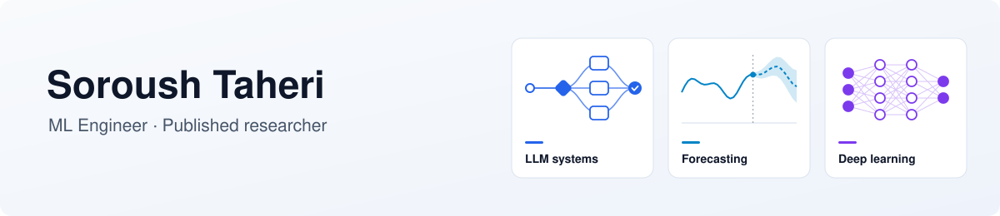

<picture>
  <source media="(prefers-color-scheme: dark)" srcset="assets/banner-dark.svg">
  
</picture>

  
  
  
  

ML Engineer building LLM systems, time-series forecasting models and applied deep learning.

**Experience areas:** LLM orchestration & retrieval · financial time-series forecasting · fault diagnosis & industrial DL · multi-agent RL

### 🛠 Stack

- **Languages:** Python · SQL 
- **ML / DL:** PyTorch · TensorFlow/Keras · scikit-learn · XGBoost · PyMC · OpenCV · librosa
- **LLMs & NLP:** Hugging Face Transformers · sentence-transformers · LangChain · CrewAI · OpenAI / OpenRouter APIs · Ollama · MCP
- **Data & retrieval:** pandas · NumPy · SQLite · PostgreSQL/PostGIS · RabbitMQ
- **Cloud & deployment:** AWS (Lambda, Batch, CDK, Step Functions) · Docker · FastAPI · Gradio · GitHub Pages
- **Apps & viz:** Next.js · Plotly · PyQt6

### 📄 Publications
- *Research trend prediction in computer science publications: a deep neural network approach*, **Scientometrics** (2022)
- *An embedding approach for analyzing the evolution of research topics with a case study on computer science subdomains*, **Scientometrics** (2023)
- *Towards study of research topics evolution in artificial intelligence based on topic embedding*, ICCKE (2021)
- *A comprehensive review of machine learning approaches for decarbonisation, energy efficiency and management in the UK building sector* (2025)

[Google Scholar](https://scholar.google.com/citations?user=hhoL598AAAAJ) · [ORCID](https://orcid.org/0000-0002-5885-3036)

### 🚀 Selected work
- **Maestro-AI**: routes queries across 46+ LLMs and uses a judge model to build consensus and flag likely hallucinations ([demo](https://soroush-thr.github.io/Maestro-AI))
- **Recall**: local-first memory system with hybrid search (BGE-M3 + reranker) and an MCP server
- **FactFlow**: multi-agent system comparing news sentiment with market price action
- **bert-gpt-analyzer**: financial-news sentiment, NER and automated reports
- **Auto-DJ**: playlists from acoustic similarity (MFCC, librosa)

Thanks for stopping by.
